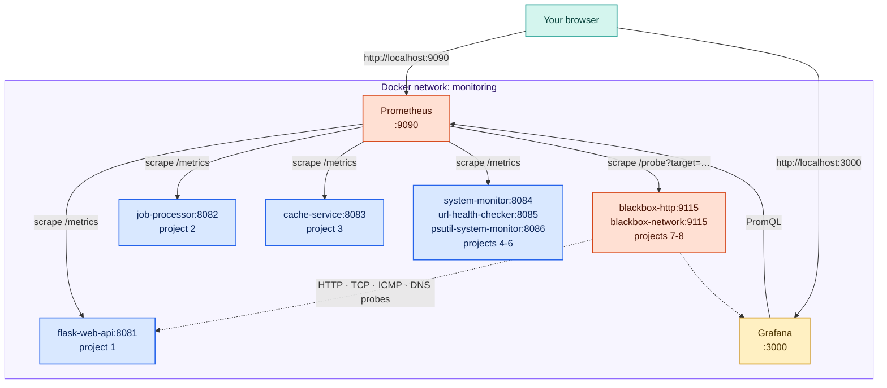

# infra/ — Shared Monitoring Infrastructure

This directory contains the **shared Prometheus and Grafana** that all projects connect to.
Start this once and leave it running while you work on the projects.

---

## What this runs



Prometheus and Grafana live on a Docker network called **`monitoring`**. Projects 1–8
join this network so Prometheus can scrape them by container name. The blackbox exporters
(Projects 7–8) are scraped like any other target, and in turn probe the other containers.

> **Scope:** everything in `projects/` runs in Docker against this stack. Apps you run natively
> on the host are scraped by the **native** Prometheus from `wsl-setup/` / `linux-setup/` /
> `mac-setup/`, not by this Docker instance.

---

## Start the infrastructure

> **Coming from `../integration/`?** That section runs its own `prometheus` and `grafana`
> containers, which use the **same names** as this stack. Docker won't let two containers
> share a name, so starting this one on top of it fails with
> `Conflict. The container name "/prometheus" is already in use`. Tear the integration
> stack down first:
> ```bash
> docker compose -f ../integration/docker-compose.yml down
> ```
> The `integration/` stack is a standalone teaching exercise — you don't keep it running
> alongside `infra/`. This `infra/` stack is the one the projects scrape against.

```bash
cd infra
docker compose up -d
```

**Expected output:**
```
[+] Running 5/5
 ✔ Network monitoring        Created
 ✔ Volume infra_promdata     Created
 ✔ Volume infra_grafdata     Created
 ✔ Container prometheus      Started
 ✔ Container grafana         Started
```

**Verify:**
```bash
docker compose ps
```

```
NAME         STATUS    PORTS
prometheus   running   0.0.0.0:9090->9090/tcp
grafana      running   0.0.0.0:3000->3000/tcp
```

Open:
- **http://localhost:9090** — Prometheus UI (run query `up` to confirm it works)
- **http://localhost:3000** — Grafana (login: `admin` / `admin`)

---

## Connect a project

Each project directory has a `CONNECT.md` with exact steps. The short version is:

1. **Start the project** from its directory: `docker compose up -d --build`
2. **Edit `infra/prometheus.yml`** — uncomment that project's job block
3. **Reload Prometheus** (no restart needed): `curl -X POST http://localhost:9090/-/reload`
4. **Verify** at `http://localhost:9090/targets` — the target should show `UP`
5. **Validate every hop** through to Grafana:
   `scripts/validate-connectivity.sh <job> [container:port] [dashboard-uid]`

| Project | Jobs to uncomment in `prometheus.yml` |
|---|---|
| 1–3 | `flask-web-api`, `job-processor`, `cache-service` |
| 4 | `system-monitor` |
| 5 | `url-health-checker` |
| 6 | `psutil-system-monitor` |
| 7 | `blackbox-http`, `blackbox-exporter-http` |
| 8 | `blackbox-tcp`, `blackbox-icmp`, `blackbox-dns`, `blackbox-exporter-network` |

Check the file before every reload — a YAML mistake makes the reload fail and Prometheus keeps
the old config:

```bash
docker exec prometheus promtool check config /etc/prometheus/prometheus.yml
```

---

## Reload Prometheus config (after editing prometheus.yml)

The `--web.enable-lifecycle` flag lets you reload without restarting:

```bash
curl -X POST http://localhost:9090/-/reload
```

**Expected output:** HTTP 200 (empty body)

Prometheus logs will show:
```
msg="Completed loading of configuration file"
```

If you prefer a restart instead:
```bash
# From this directory:
docker compose restart prometheus
```

> **Why reload is reliable here:** `docker-compose.yml` mounts the whole `infra/` directory at
> `/etc/prometheus` rather than the single file. Many editors save by writing a new file and
> renaming it over the old one; a single-file bind mount keeps pointing at the *old* file, so a
> reload would re-read stale config. A directory mount always shows the current file — and
> `docker exec prometheus promtool check config /etc/prometheus/prometheus.yml` checks what you
> actually saved.

---

## Pre-loaded Grafana dashboards

Every JSON file in `grafana/dashboards/` is provisioned automatically into
**Dashboards → Projects**:

| Dashboard | Project |
|---|---|
| All Projects Overview | rows for Projects 1–3 |
| Flask Web API / Job Processor / Cache Service | 1 / 2 / 3 |
| System Monitor | 4 |
| URL Health Checker | 5 |
| psutil System Monitor | 6 |
| Blackbox HTTP Probes | 7 |
| Blackbox Network Probes | 8 |

Panels for projects that are not running show "No data" until that project is started and
connected. Grafana rescans the folder every few seconds, so a new JSON file appears without a
restart.

---

## Files

| File | Purpose |
|------|---------|
| `docker-compose.yml` | Prometheus + Grafana; creates the `monitoring` network |
| `prometheus.yml` | Scrape config — uncomment project jobs to enable scraping |
| `grafana/provisioning/datasources/prometheus.yml` | Auto-registers Prometheus in Grafana |
| `grafana/provisioning/dashboards/dashboard.yml` | Dashboard provider config |
| `grafana/dashboards/all-projects-overview.json` | Combined dashboard (projects 1–3) |
| `grafana/dashboards/flask-web-api.json` | Project 1 standalone dashboard |
| `grafana/dashboards/job-processor.json` | Project 2 standalone dashboard |
| `grafana/dashboards/cache-service.json` | Project 3 standalone dashboard |
| `grafana/dashboards/system-monitor.json` | Project 4 dashboard |
| `grafana/dashboards/url-health-checker.json` | Project 5 dashboard |
| `grafana/dashboards/psutil-system-monitor.json` | Project 6 dashboard |
| `grafana/dashboards/blackbox-http.json` | Project 7 dashboard |
| `grafana/dashboards/blackbox-network.json` | Project 8 dashboard |

> Each project keeps its own copy in `projects/<name>/dashboards/` for importing into a
> Grafana that doesn't use this provisioning (for example a native install).

---

## Stop / reset

```bash
# Stop but keep data (dashboards, Prometheus history):
docker compose down

# Full reset — wipes all stored data:
docker compose down -v
```

> After `docker compose down -v`, the next `docker compose up -d` starts completely fresh.
> Any dashboards you created manually in Grafana will be lost (provisioned ones come back automatically).

---

## Ports

| Service    | Port | URL |
|------------|------|-----|
| Prometheus | 9090 | http://localhost:9090 |
| Grafana    | 3000 | http://localhost:3000 |
