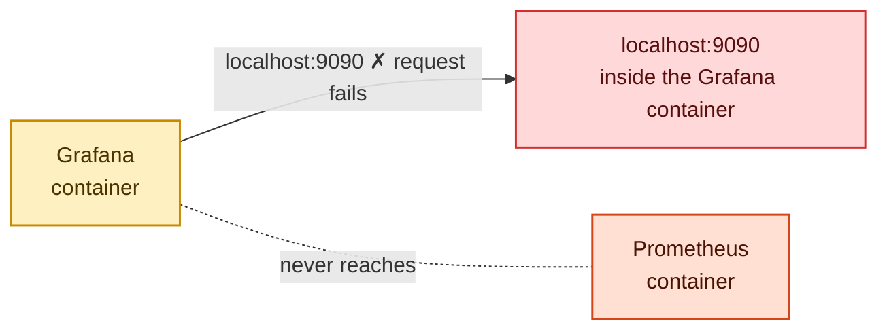
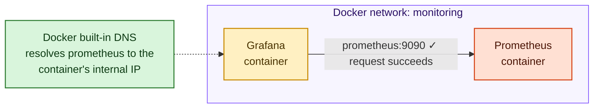
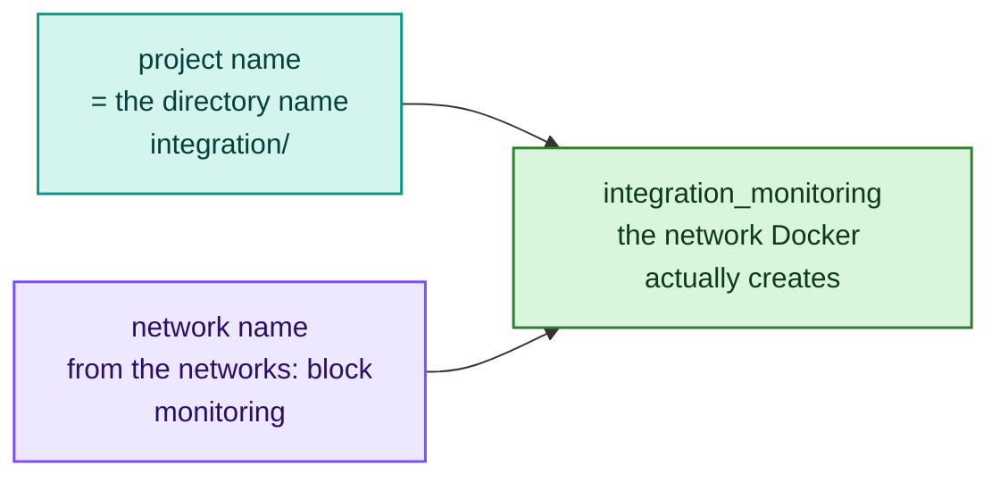
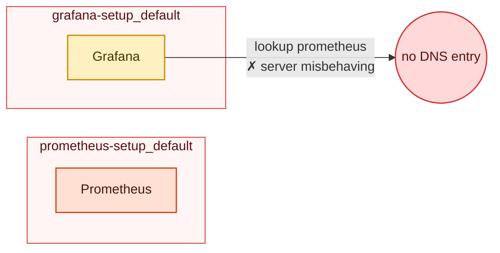
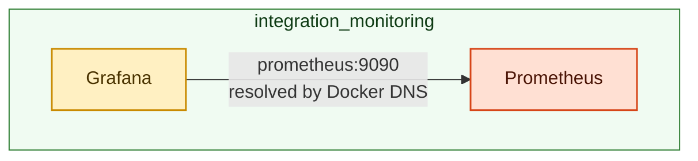
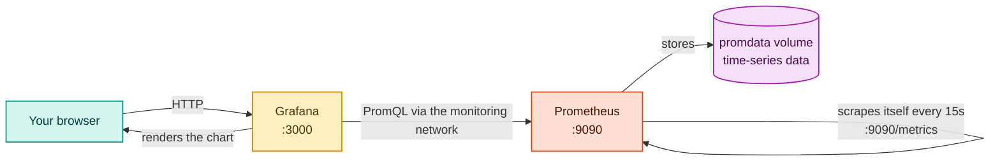

# Integration — Prometheus + Grafana Together

> **Why this section matters:** Running each tool on its own is easy. The interesting
> (and often confusing) part is connecting them. This section explains *how* Grafana
> talks to Prometheus and *why* the naive approach (`localhost`) fails.

---

## How Grafana talks to Prometheus

When Grafana needs to display a graph, it sends a PromQL query to Prometheus's HTTP API.
The key question is: **what URL does Grafana use to reach Prometheus?**

### The wrong answer: `http://localhost:9090`

❌ **Wrong**



Each container has its own localhost. Grafana's localhost *is* the Grafana container
itself — port 9090 does not exist inside it, so the request fails.

### The right answer: `http://prometheus:9090`

✅ **Correct**



Both containers are on the same Docker network, so Docker's built-in DNS resolves
`prometheus` to the Prometheus container's internal IP address.

**The rule:** When one container needs to talk to another, use the **service name** (or
container name) as the hostname — never `localhost`.

---

## Where do these networks come from?

You don't usually create Docker networks by hand — Compose creates one for you every time
you run `docker compose up`. Understanding *how it names them* explains the single most common
integration failure.

### Rule 1 — Compose always creates a network, named `<project>_<network>`

The **project name** defaults to the name of the directory the `docker-compose.yml` lives in.
So running `docker compose up` from `integration/` (whose compose file defines a network called
`monitoring`) produces a network named:



Every service with `networks: - monitoring` is attached to it, and Docker adds a DNS entry on
that network for each service name. That's what makes `http://prometheus:9090` resolvable.

### Rule 2 — No `networks:` block? You get a network called `<project>_default`

If a compose file *doesn't* define any network, Compose still creates one, named
`<project>_default`, and quietly attaches the services to it. A single-service file like
`prometheus-setup/docker-compose.yml` therefore gets its own private `prometheus-setup_default`
network — fine on its own, but isolated from everything else.

### Why running the two standalone stacks separately breaks



Docker's DNS only resolves a name **within the same network**. Across two `_default` networks
there is no route, so the lookup of `prometheus` fails. (See
[../docs/troubleshooting.md → section 4](../docs/troubleshooting.md#4-grafana-cannot-reach-prometheus--the-localhost-trap).)

**This `integration/` setup fixes it by design:** its one compose file defines both services
*and* a shared `monitoring` network, so both land on `integration_monitoring` together:



The takeaway: keep services that must talk to each other in **one compose file** (or on one
explicitly-shared network) — never start them from separate directories and expect them to
find each other.

---

## How it all fits together



---

## What you will build

Prometheus and Grafana running together, auto-configured via provisioning:
- Prometheus registered as a Grafana data source automatically (no manual clicks)
- A starter "Prometheus Overview" dashboard loaded automatically

---

## Prerequisites

- Completed `../prometheus-setup/` and `../grafana-setup/`
- No containers named `prometheus` or `grafana` are running
- You are in the `integration/` directory

---

## Learning path (do these in order)

### Step 1 — The manual way
Read and follow **[01-docker-cli.md](01-docker-cli.md)**.

You will create a Docker network by hand, run both containers on it, test the connection
from inside the Grafana container, and verify the pre-loaded dashboard.

### Step 2 — The Compose shortcut
Read and follow **[02-docker-compose.md](02-docker-compose.md)**.

You will see how the network, volumes, services, and `depends_on` map back to the manual
commands, and start the entire stack with `docker compose up -d`.

---

## Files in this directory

| Path | Purpose |
|------|---------|
| `prometheus.yml` | Prometheus config (same structure, with Grafana scrape commented out) |
| `grafana/provisioning/datasources/prometheus.yml` | Auto-registers Prometheus as Grafana data source |
| `grafana/provisioning/dashboards/dashboard.yml` | Tells Grafana where to load dashboard JSON files |
| `grafana/dashboards/prometheus-overview.json` | Pre-built starter dashboard |
| `01-docker-cli.md` | Manual walkthrough |
| `docker-compose.yml` | Compose file (both services + network) |
| `02-docker-compose.md` | Compose walkthrough + mapping table |

---

## Key concepts introduced here

| Concept | One-line definition |
|---------|-------------------|
| Docker network | A virtual bridge that lets containers reach each other by name |
| Service name DNS | Docker resolves container/service names to IPs on the same network |
| Provisioning | Grafana auto-loading data sources and dashboards from config files on startup |
| `depends_on` | Compose start-order hint (does not guarantee readiness) |
| `--network` flag | Attaches a container to a named network |

---

## Quick reference

| Service | Port | URL |
|---------|------|-----|
| Prometheus | 9090 | http://localhost:9090 |
| Grafana | 3000 | http://localhost:3000 |

**Grafana login:** `admin` / `admin`

---

## Troubleshooting

**`Post "http://prometheus:9090/api/v1/query": ... lookup prometheus on 127.0.0.11:53:
server misbehaving`** — Grafana can't resolve the name `prometheus`. This almost always
means Grafana and Prometheus are on **different Docker networks** (e.g. you started them from
the standalone `../prometheus-setup/` and `../grafana-setup/` dirs, which each create their
own isolated network). Run both from *this* `integration/` directory instead so they share
one network:

```bash
docker compose -f ../prometheus-setup/docker-compose.yml down
docker compose -f ../grafana-setup/docker-compose.yml down
docker compose up -d           # from integration/

# verify both are on the same network and DNS works:
docker ps --format 'table {{.Names}}\t{{.Networks}}'
docker exec grafana wget -qO- http://prometheus:9090/-/healthy   # → Prometheus Server is Healthy.
```

Full write-up (including the `localhost` variant and a quick-patch alternative):
[../docs/troubleshooting.md → section 4](../docs/troubleshooting.md#4-grafana-cannot-reach-prometheus--the-localhost-trap).

---

## After completing this section

**First stop this stack** — it uses the container names `prometheus` and `grafana`, the same
names `infra/` uses, so leaving it running makes the `infra/` start fail with
`Conflict. The container name "/prometheus" is already in use`:

```bash
docker compose down          # from integration/
```

Then head to **[../infra/](../infra/)** to start the shared monitoring stack, then pick a
project from `projects/` (Projects 1–8, Docker path) to build real applications that expose
custom metrics and dashboards.
