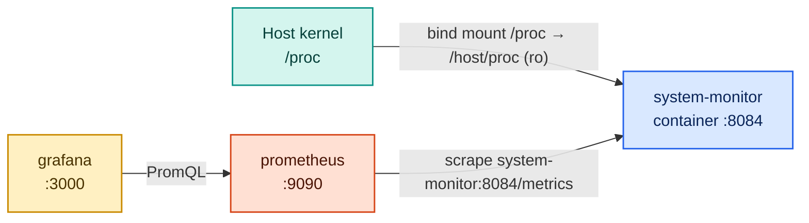

# Project 4 — System Monitor (raw `/proc`)

A Python/Flask app that reads the Linux `/proc` filesystem by hand and exposes host system
metrics — CPU, memory, swap, load, disk I/O, uptime — for Prometheus to scrape.

It runs as a **container** on the shared `monitoring` network, but it reports on the **host**,
not on itself: `docker-compose.yml` mounts the host's `/proc` read-only at `/host/proc`, and
the app reads from there. That is exactly how Node Exporter (the standard Prometheus system
agent) is run in Docker — `--path.procfs=/host/proc` — so this project shows you what such an
agent does under the hood.

> **What is "the host"?** On Linux it is your machine. On Docker Desktop (Windows/WSL2 or
> macOS) containers run inside a small Linux VM, so the numbers describe that VM. On WSL2 the
> VM shares the WSL2 kernel, so the values match what `free` / `uptime` show in your WSL shell.

---

## What it does

Every 5 seconds a background thread reads these files and updates the gauges:

```
/host/proc/stat      → CPU usage per core (user/system/idle/iowait jiffies)
/host/proc/meminfo   → total RAM, available RAM, swap usage
/host/proc/loadavg   → 1-minute, 5-minute, 15-minute load averages
/host/proc/diskstats → cumulative sectors read/written per block device
/host/proc/uptime    → seconds since last boot
```

Routes:

```
GET /          → {"proc_root": "/host/proc", "service": "system-monitor", "status": "ok"}
GET /snapshot  → current readings as human-readable JSON
GET /metrics   → Prometheus scrapes this
```



---

## Metrics produced

| Metric | Type | Labels | What it measures |
|--------|------|--------|-----------------|
| `system_cpu_usage_percent` | Gauge | — | Overall CPU busy % (0–100) |
| `system_cpu_core_usage_percent` | Gauge | core | Per-core CPU busy % |
| `system_memory_total_bytes` | Gauge | — | Total installed RAM |
| `system_memory_available_bytes` | Gauge | — | Free + reclaimable RAM |
| `system_memory_usage_percent` | Gauge | — | RAM used as percentage |
| `system_swap_total_bytes` | Gauge | — | Total swap space |
| `system_swap_used_bytes` | Gauge | — | Swap currently in use |
| `system_load_average` | Gauge | interval | Load avg (`1m`, `5m`, `15m`) |
| `system_disk_read_bytes_total` | Gauge | device | Cumulative bytes read since boot |
| `system_disk_write_bytes_total` | Gauge | device | Cumulative bytes written since boot |
| `system_uptime_seconds` | Gauge | — | Seconds since last boot |

**Why all Gauges?**
These are readings copied from the kernel, not events the app counts itself. A Gauge fits a
value that goes up and down (CPU %, memory %). The disk byte totals only grow, but the app
just *reports* the kernel's number, so a Gauge works and you still use `rate()` in PromQL to
turn it into bytes per second.

**Why mount `/proc` at all?** Most of these files (`stat`, `meminfo`, `loadavg`) show host-wide
values even inside a container, because the kernel does not split them per container. Mounting
the host `/proc` makes the intent explicit and also covers the files that *are* per container
(`/proc/net/*`, process lists). It is the production pattern — don't rely on the leak.

---

## Quick start

```bash
# 1. Start shared infra (if not already running)
cd infra && docker compose up -d && cd ..

# 2. Start this project
cd projects/04-system-monitor
docker compose up -d --build

# 3. Test the app
curl http://localhost:8084/
curl http://localhost:8084/snapshot

# 4. Connect to Prometheus + Grafana and validate every hop
# Follow CONNECT.md
```

---

## Files

| File | Purpose |
|------|---------|
| `app/app.py` | Flask app that reads `/proc` (under `PROC_ROOT`) and exposes metrics |
| `app/requirements.txt` | `flask`, `prometheus-client` |
| `app/Dockerfile` | Container image; sets `PROC_ROOT=/host/proc` |
| `docker-compose.yml` | Runs the app on `monitoring`, mounts host `/proc` read-only |
| `CONNECT.md` | Wire into Prometheus, validate connectivity, open the dashboard |
| `CLEANUP.md` | Remove everything this project added |
| `dashboards/system-monitor.json` | Grafana dashboard (also auto-provisioned by `infra/`) |

---

## Port

| Service | Port | URL |
|---------|------|-----|
| System Monitor | 8084 | http://localhost:8084 |
| Snapshot | 8084 | http://localhost:8084/snapshot |
| Metrics | 8084 | http://localhost:8084/metrics |
