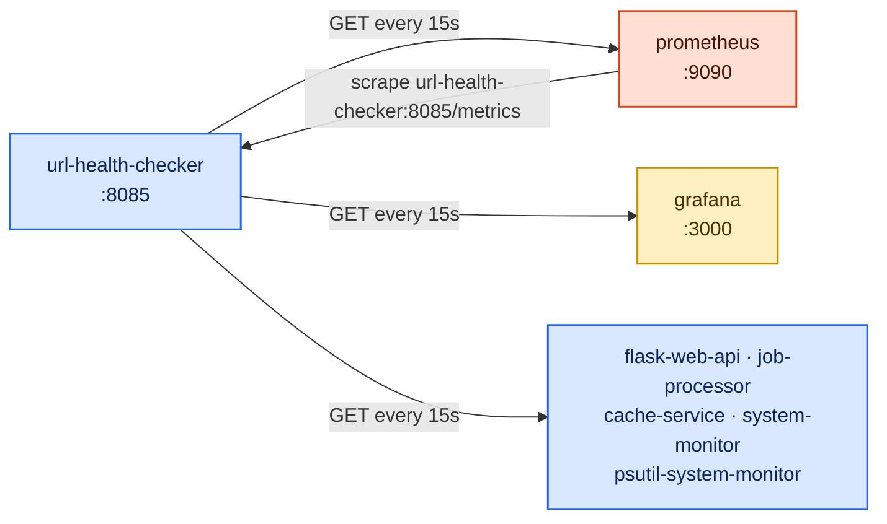

# Project 5 — URL Health Checker

A Python/Flask app that polls a list of URLs every 15 seconds and turns each result into
Prometheus metrics: is it up, what status code came back, how long it took. It is a
hand-written, simplified Blackbox Exporter — build this one first and Projects 7 and 8 (the real
Blackbox Exporter) will feel familiar.

It runs as a container on the shared `monitoring` network and checks the other containers
**by container name**: `http://prometheus:9090/-/healthy`, `http://flask-web-api:8081/`, and so
on. Inside a container, `localhost` is the container itself, so `http://localhost:9090` would
never reach Prometheus.

---

## What it does



Default targets (set by `TARGETS` in `docker-compose.yml`):

| URL | Service |
|-----|---------|
| `http://prometheus:9090/-/healthy` | Prometheus |
| `http://grafana:3000/api/health` | Grafana |
| `http://flask-web-api:8081/` | Project 1 |
| `http://job-processor:8082/stats` | Project 2 |
| `http://cache-service:8083/stats` | Project 3 |
| `http://system-monitor:8084/` | Project 4 |
| `http://psutil-system-monitor:8086/` | Project 6 |

Projects that are not running show as **down** — that is the checker working, not failing.

Routes:

```
GET    /         → {"service": "url-health-checker", "status": "ok"}
GET    /targets  → list monitored URLs
POST   /targets  → add a URL       body: {"url": "http://..."}
DELETE /targets  → remove a URL    body: {"url": "http://..."}
GET    /status   → current up/down of every URL
GET    /metrics  → Prometheus scrapes this
```

---

## Metrics produced

| Metric | Type | Labels | What it measures |
|--------|------|--------|-----------------|
| `url_up` | Gauge | url | 1 if the last check got HTTP < 400, else 0 |
| `url_status_code` | Gauge | url | Last status code (0 = connection error / timeout) |
| `url_response_seconds` | Histogram | url | Response time distribution |
| `url_checks_total` | Counter | url, result | Checks done, `result` = `success` / `error` |

**Why these types?**
- **Gauge** for `url_up` and `url_status_code` — they describe the *current* state and can go
  either way.
- **Histogram** for response time — lets you compute p50/p95 per URL with `histogram_quantile()`.
- **Counter** for checks — only grows; `rate()` turns it into checks/errors per second.

> Note `result="success"` means "the HTTP request completed", even with a 500. A 500 shows up as
> `url_up=0` with `url_status_code=500`. `result="error"` means no response at all (DNS failure,
> refused connection, timeout).

---

## Quick start

```bash
cd infra && docker compose up -d && cd ..
cd projects/05-url-health-checker
docker compose up -d --build

curl http://localhost:8085/status
```

Then follow **[CONNECT.md](CONNECT.md)**.

---

## Configuration

| Env var (in `docker-compose.yml`) | Default | Meaning |
|---|---|---|
| `TARGETS` | the 7 URLs above | Comma-separated URLs to poll |
| `CHECK_INTERVAL_SECONDS` | `15` | Seconds between rounds |

URLs added with `POST /targets` live in memory only — they are lost when the container restarts.
For permanent changes, edit `TARGETS` and run `docker compose up -d`.

---

## Files

| File | Purpose |
|------|---------|
| `app/app.py` | Poller + Flask API + metrics |
| `app/requirements.txt` | `flask`, `prometheus-client`, `requests` |
| `app/Dockerfile` | Container image |
| `docker-compose.yml` | Runs the checker on `monitoring` with the target list |
| `CONNECT.md` | Wire into Prometheus, validate connectivity, open the dashboard |
| `CLEANUP.md` | Remove everything this project added |
| `dashboards/url-health-checker.json` | Grafana dashboard (also auto-provisioned by `infra/`) |

---

## Port

| Service | Port | URL |
|---------|------|-----|
| URL Health Checker | 8085 | http://localhost:8085/status |
| Metrics | 8085 | http://localhost:8085/metrics |
