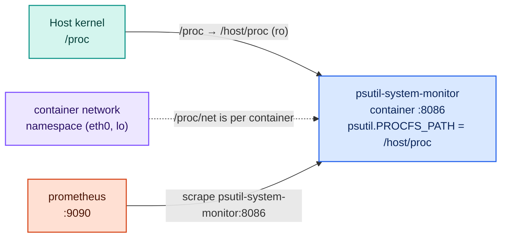

# Project 6 — psutil System Monitor

The same host metrics as Project 4 — CPU, memory, load, disk, uptime — plus disk usage and
network counters, but collected with the cross-platform **`psutil`** library instead of parsing
`/proc` by hand. Run 04 and 06 side by side and compare: same numbers, a fraction of the code.

| | Project 4 | Project 6 |
|---|---|---|
| How it reads | `open("/host/proc/stat")` and parse fields by hand | `psutil.cpu_percent()` |
| Metric prefix | `system_*` | `host_*` |
| Runs natively on | Linux only | Linux, macOS, Windows |
| Teaches | what the kernel actually exposes | portability through a library |

> **Where this project comes from.** In the native track, Project 6 is the "Mac System
> Monitor": this exact psutil code running directly on macOS. A container **cannot** see a macOS
> host — Docker Desktop runs containers inside a Linux VM — so the container edition reports on
> the Linux machine Docker runs on (your Linux box, the WSL2 VM, or the Docker Desktop VM). The
> collector code is unchanged; only the `HOST_OS` label says `linux`.

---

## How it sees the host from inside a container



| Setting | Where | Why |
|---|---|---|
| `PROCFS_PATH=/host/proc` | Dockerfile | psutil reads the host's `/proc` (mounted read-only) |
| `DISK_PATHS=/` | docker-compose.yml | Inside a container `psutil.disk_partitions()` lists Docker's bind-mounted files (`/etc/hosts`, `/etc/resolv.conf`). We report `/` instead — the container root, which sits on Docker's data disk |
| `HOST_OS=linux` | docker-compose.yml | Value of the `os` label on `host_info` |

**Network counters are the container's own.** `/proc/net/dev` belongs to the reading process's
network namespace, so `host_net_bytes_*` shows the container's `eth0` and `lo`, not the host
NICs. Node Exporter has the same limit and is run with `network_mode: host` when host NICs are
needed — which would take it *off* the `monitoring` network. A good trade-off to know about.

**Battery** comes from `/sys/class/power_supply`. On a laptop running WSL2 it shows your real
battery; on servers and most VMs the gauge stays empty.

---

## Metrics produced

| Metric | Type | Labels | What it measures |
|--------|------|--------|-----------------|
| `host_cpu_usage_percent` | Gauge | — | Overall CPU busy % |
| `host_cpu_core_usage_percent` | Gauge | core | Per-core CPU busy % |
| `host_memory_total_bytes` / `_used_bytes` / `_usage_percent` | Gauge | — | RAM |
| `host_swap_total_bytes` / `_used_bytes` | Gauge | — | Swap |
| `host_load_average` | Gauge | interval | 1m / 5m / 15m load |
| `host_disk_usage_percent` | Gauge | mount | Filesystem used % |
| `host_disk_read_bytes_total` / `_write_bytes_total` | Gauge | — | Disk I/O since boot (all disks) |
| `host_net_bytes_sent_total` / `_recv_total` | Gauge | nic | Network bytes since start (container NICs) |
| `host_battery_percent` / `host_battery_plugged` | Gauge | — | Battery, when present |
| `host_uptime_seconds` | Gauge | — | Seconds since boot |
| `host_info` | Gauge | os | Always 1; carries the `os` label |

---

## Quick start

```bash
cd infra && docker compose up -d && cd ..
cd projects/06-psutil-system-monitor
docker compose up -d --build

curl http://localhost:8086/snapshot
```

Then follow **[CONNECT.md](CONNECT.md)**.

---

## Files

| File | Purpose |
|------|---------|
| `app/app.py` | psutil collector + Flask routes |
| `app/requirements.txt` | `flask`, `prometheus-client`, `psutil` |
| `app/Dockerfile` | Container image; sets `PROCFS_PATH=/host/proc` |
| `docker-compose.yml` | Runs on `monitoring`, mounts host `/proc` read-only |
| `CONNECT.md` | Wire into Prometheus, validate connectivity, open the dashboard |
| `CLEANUP.md` | Remove everything this project added |
| `dashboards/psutil-system-monitor.json` | Grafana dashboard (also auto-provisioned by `infra/`) |

---

## Port

| Service | Port | URL |
|---------|------|-----|
| psutil System Monitor | 8086 | http://localhost:8086/snapshot |
| Metrics | 8086 | http://localhost:8086/metrics |
