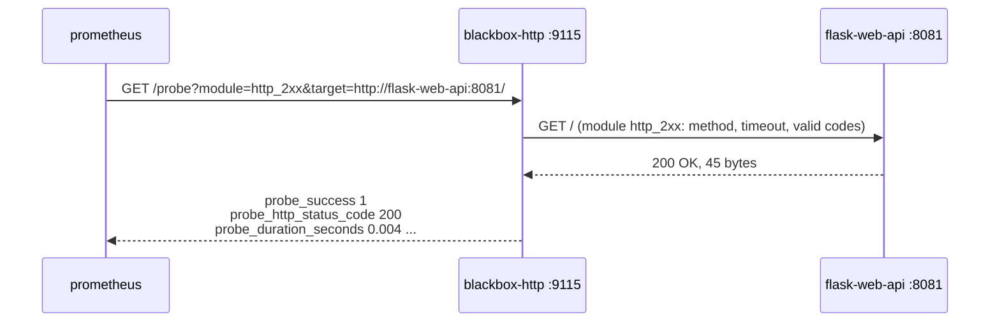

# Project 7 — Blackbox HTTP Probes

Probe monitoring with the official **Prometheus Blackbox Exporter**. Instead of asking an app
to report on itself (`/metrics`), the exporter tests it **from the outside**, the way a user
would: send an HTTP request, check the status code and body, time every phase.

There is no app to build in this project. The exporter probes the containers that are already
running on the `monitoring` network — Prometheus, Grafana and Projects 1–6.

> Project 5 was a hand-made version of this idea. Compare them: Project 5 polls on its own
> timer and you write the checks in Python; the Blackbox Exporter probes **when Prometheus
> scrapes it**, and you describe the checks in YAML.

---

## White-box vs black-box monitoring

| | White-box (Projects 1–6) | Black-box (Projects 7–8) |
|---|---|---|
| Who produces the data | The app itself, on `/metrics` | An outside prober |
| Answers | *Why* is it slow? Which endpoint errors? | *Is it up* for a user? How long does it take? |
| Sees a crashed app as | Scrape fails → `up == 0` (no detail) | `probe_success == 0`, plus the failing phase |
| Needs code changes | Yes — instrument the app | No — works on anything with a URL |

You want both: black-box tells you users are hurting, white-box tells you why.

---

## How a probe scrape works



Prometheus scrapes the **exporter**, passing the real target as a URL parameter. That is why
the scrape job in `infra/prometheus.yml` uses `relabel_configs`:

| Relabel step | Effect |
|---|---|
| `__address__` → `__param_target` | The URL you listed becomes `?target=` |
| `module` label → `__param_module` | Each target group picks its module: `?module=` |
| `__param_target` → `instance` | Graphs show the probed URL, not the exporter address |
| `__address__` = `blackbox-http:9115` | The actual HTTP request goes to the exporter |

---

## Modules in `blackbox.yml`

| Module | Checks | Probed targets |
|---|---|---|
| `http_2xx` | GET returns any 2xx | Projects 1–6 |
| `http_body_ok` | GET returns 200 **and** body matches `"status":"ok"` / `"database":"ok"` | Grafana, Projects 1 and 4 |
| `http_prometheus_healthy` | 200 and body contains `Healthy` | Prometheus `/-/healthy` |
| `http_post_job` | POST a JSON body, expect **202** | Project 2 `/jobs` |
| `https_2xx_tls` | HTTPS only, records certificate expiry | `https://prometheus.io`, `https://grafana.com` (needs internet) |

> `http_post_job` really submits a job to Project 2 every 15 seconds. That is a *synthetic
> transaction* — it exercises the real code path, and it shows up in Project 2's own metrics
> (`jobs_submitted_total`). Keep that in mind before pointing POST probes at production.

---

## Metrics produced (per probe)

| Metric | Meaning |
|--------|---------|
| `probe_success` | 1 if every check in the module passed, else 0 |
| `probe_duration_seconds` | Total time for the probe |
| `probe_http_status_code` | Status code received (0 = no response) |
| `probe_http_duration_seconds{phase}` | Time per phase: `resolve`, `connect`, `tls`, `processing`, `transfer` |
| `probe_http_content_length` | Response body size |
| `probe_failed_due_to_regex` | 1 if the body regex check failed |
| `probe_ssl_earliest_cert_expiry` | Unix time the first certificate in the chain expires (HTTPS) |
| `probe_dns_lookup_time_seconds` | Time to resolve the target host name |

`up{job="blackbox-http"}` means "Prometheus reached the **exporter**", not the target. A dead
target still gives `up == 1` with `probe_success == 0`. Alert on `probe_success`.

---

## Quick start

```bash
cd infra && docker compose up -d && cd ..
cd projects/07-blackbox-http-probes
docker compose up -d

# Run one probe by hand:
curl 'http://localhost:9115/probe?module=http_2xx&target=http://flask-web-api:8081/'
```

Then follow **[CONNECT.md](CONNECT.md)**.

---

## Files

| File | Purpose |
|------|---------|
| `blackbox.yml` | Probe modules (mounted read-only into the exporter) |
| `docker-compose.yml` | `prom/blackbox-exporter:v0.27.0` on `monitoring`, port 9115 |
| `CONNECT.md` | Probe by hand, wire into Prometheus, validate, break things, dashboard |
| `CLEANUP.md` | Remove everything this project added |
| `dashboards/blackbox-http.json` | Grafana dashboard (also auto-provisioned by `infra/`) |

---

## Port

| Service | Port | URL |
|---------|------|-----|
| Blackbox Exporter (HTTP) | 9115 | http://localhost:9115 — recent probes with debug logs |
| Probe endpoint | 9115 | http://localhost:9115/probe?module=…&target=… |
| Exporter's own metrics | 9115 | http://localhost:9115/metrics |
