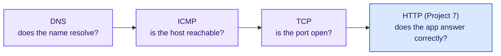

# Project 8 — Blackbox Network Probes (TCP · ICMP · DNS)

Project 7 asked "does the web page answer correctly?". This project goes one layer down, with
a second Blackbox Exporter that runs **TCP**, **ICMP (ping)** and **DNS** probes against the
same containers. These are the checks you reach for when an HTTP probe fails and you need to
know *where* it breaks:



| HTTP fails, and… | Most likely |
|---|---|
| DNS fails | Container not running / not on the `monitoring` network / wrong name |
| DNS ok, ping fails | Network path problem (rare on one Docker host) |
| Ping ok, TCP fails | Process crashed or listens on another port / only on 127.0.0.1 |
| TCP ok, HTTP fails | The app is up but broken — check its logs and white-box metrics |

---

## Why a second exporter?

One exporter could run every module. A separate one keeps each project self-contained (start,
break and clean up 08 without touching 07) and shows that probers are cheap, stateless and
easy to run in several places — real setups place probers in different regions to tell "the
site is down" apart from "one network path is down".

It uses host port **9116** because Project 7 already owns 9115. Inside the network it still
listens on 9115, so Prometheus reaches it at `blackbox-network:9115`.

---

## Modules in `blackbox.yml`

| Module | Prober | Checks | Targets (from `infra/prometheus.yml`) |
|---|---|---|---|
| `tcp_connect` | tcp | TCP handshake completes | Every service port, plus `grafana:9999` (**expected down**) |
| `tcp_grafana_http_banner` | tcp | Sends a raw `GET /api/health`, expects `HTTP/1.x 200` | `grafana:3000` |
| `icmp_ping` | icmp | Echo reply received | Container names |
| `dns_container_prometheus` | dns | `prometheus` resolves to an A record | `127.0.0.11:53` |
| `dns_container_missing` | dns | `no-such-service` resolves (it won't → NXDOMAIN) | `127.0.0.11:53` (**expected down**) |
| `dns_external` | dns | `prometheus.io` resolves | `1.1.1.1:53`, `8.8.8.8:53` (needs internet) |

**`127.0.0.11` is Docker's embedded DNS server.** It exists inside every container attached to a
user-defined network and answers for container names. Probing it from the exporter's container
tests the exact lookup Grafana makes before it can reach `http://prometheus:9090`.

**Expected-down targets** carry the label `expected="down"`. They fail on purpose, so the
dashboard always has an example of a failed TCP and DNS probe — and the "Unexpected Failures"
panel filters them out with `expected!="down"`. Labelling known exceptions is a common way to
keep alert rules quiet.

**ICMP permissions.** The exporter runs as a non-root user. Sending ping without root needs
"unprivileged ICMP" sockets, allowed by the kernel setting `net.ipv4.ping_group_range`. Docker
20.10+ sets it in every container; `docker-compose.yml` sets it explicitly anyway.

---

## Metrics produced (per probe)

| Metric | Prober | Meaning |
|--------|--------|---------|
| `probe_success` | all | 1 if the probe passed |
| `probe_duration_seconds` | all | Total probe time |
| `probe_ip_protocol` | all | 4 or 6 |
| `probe_icmp_duration_seconds{phase}` | icmp | `resolve`, `setup`, `rtt` |
| `probe_icmp_reply_hop_limit` | icmp | TTL of the reply |
| `probe_dns_answer_rrs` | dns | Records in the answer section |
| `probe_dns_query_succeeded` | dns | 1 if the server answered at all (even NXDOMAIN) |
| `probe_dns_lookup_time_seconds` | all | Time to resolve the *target's* own name |
| `probe_failed_due_to_regex` | tcp | 1 if a `query_response` expectation failed |

---

## Quick start

```bash
cd infra && docker compose up -d && cd ..
cd projects/08-blackbox-network-probes
docker compose up -d

curl 'http://localhost:9116/probe?module=tcp_connect&target=grafana:3000'
```

Then follow **[CONNECT.md](CONNECT.md)**.

---

## Files

| File | Purpose |
|------|---------|
| `blackbox.yml` | TCP / ICMP / DNS modules |
| `docker-compose.yml` | `prom/blackbox-exporter:v0.27.0` as `blackbox-network`, host port 9116 |
| `CONNECT.md` | Probe by hand, wire into Prometheus, validate, break things, dashboard |
| `CLEANUP.md` | Remove everything this project added |
| `dashboards/blackbox-network.json` | Grafana dashboard (also auto-provisioned by `infra/`) |

---

## Port

| Service | Host port | URL |
|---------|-----------|-----|
| Blackbox Exporter (network) | 9116 | http://localhost:9116 |
| Inside the `monitoring` network | 9115 | `blackbox-network:9115` |
