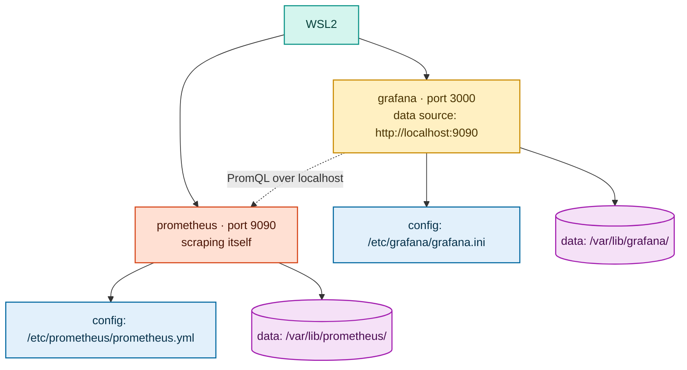

# Connect Prometheus to Grafana

At this point you have Prometheus running on port 9090 and Grafana running on port 3000. This step adds Prometheus as a data source inside Grafana so you can run queries and build dashboards.

---

## Prerequisites

- Prometheus is running: `curl -s http://localhost:9090/-/healthy` returns `Prometheus Server is Healthy.`
- Grafana is running: `curl -s http://localhost:3000/api/health` returns `{"database": "ok", ...}`

---

## Step 1 — Add Prometheus as a data source

**Via the Grafana UI:**

1. Open **http://localhost:3000** and log in (`admin` / `admin`)
2. Click the hamburger menu (☰) in the top-left → **Connections** → **Data sources**
3. Click **Add data source**
4. Select **Prometheus**
5. Set the URL to:
   ```
   http://localhost:9090
   ```
6. Leave all other settings at their defaults
7. Click **Save & test**

Expected result: a green banner saying **"Successfully queried the Prometheus API."**

**Via the API (alternative — no browser needed):**

```bash
curl -s -u admin:admin \
  -X POST http://localhost:3000/api/datasources \
  -H "Content-Type: application/json" \
  -d '{
    "name": "Prometheus",
    "type": "prometheus",
    "url": "http://localhost:9090",
    "access": "proxy",
    "isDefault": true
  }' | python3 -m json.tool
```

Expected output includes:
```json
{
    "message": "Datasource added",
    "name": "Prometheus"
}
```

---

## Step 2 — Verify with a test query

1. In Grafana, click the hamburger menu → **Explore**
2. Make sure the data source dropdown at the top shows **Prometheus**
3. In the query box, type:
   ```promql
   up
   ```
4. Click **Run query** (Shift+Enter)

You should see a result with value `1` for the `prometheus` job. This confirms Grafana can query Prometheus.

---

## Step 3 — Import a dashboard (optional)

Grafana can load any dashboard that exists as a standalone JSON file:

1. Click the hamburger menu → **Dashboards** → **New** → **Import**
2. Click **Upload dashboard JSON file**
3. Select a dashboard JSON file (the Projects 1–8 dashboards live in
   `projects/<project>/dashboards/` and `infra/grafana/dashboards/`)
4. On the next screen, select **Prometheus** as the data source
5. Click **Import**

The dashboard will open. Panels will show "No data" until the matching app is running and this Prometheus is scraping it.

---

## Step 4 — Verify the complete chain

Check that Prometheus is collecting data:
```bash
curl -s 'http://localhost:9090/api/v1/query?query=up' | python3 -c "
import sys, json
d = json.load(sys.stdin)
for r in d['data']['result']:
    print(r['metric']['job'], '→', r['value'][1])
"
```

Expected output:
```
prometheus → 1
```

Once you start local exporters and uncomment their scrape jobs, this list grows:
```
prometheus → 1
system-monitor → 1
url-health-checker → 1
```

---

## Prometheus config location reminder

For the native setup, the Prometheus config is at `/etc/prometheus/prometheus.yml`.
To add a new scrape target, edit that file and reload:

```bash
sudo nano /etc/prometheus/prometheus.yml
# ... uncomment the project block ...

curl -X POST http://localhost:9090/-/reload
```

This is the same `/-/reload` endpoint used in the Docker setup — the flag `--web.enable-lifecycle` enables it in both cases.

---

## Summary — what you have now



Next: point this Prometheus at an app that exposes `/metrics`, then build a dashboard for it.
